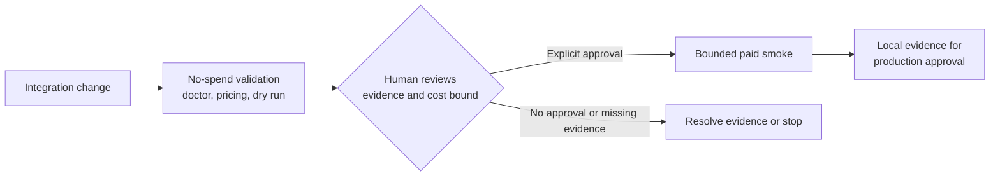

# LLM Preflight

<!-- mcp-name: io.github.feronovak/llm-preflight -->

**Last reviewed:** 2026-10-19 · **As of:** v2.22.1

[](https://pypi.org/project/llm-preflight/)
[](https://github.com/feronovak/llm-preflight/actions/workflows/tests.yml)
[](https://github.com/feronovak/llm-preflight/blob/main/LICENSE)

**No preflight, no merge.**

Catch responses your application cannot use before merging model, prompt,
schema, or provider changes. Declare the JSON shape, routing labels, or exact
output your feature needs, then check whether responses meet those rules.

Built for small engineering teams maintaining an LLM feature. Runs locally
as a CLI, GitHub Action, or MCP server, with no runtime dependencies.

**Watch an invalid response get caught and fixed (23 seconds).**

`billing` passes → change the response to `sales` → check fails → restore
`billing` → check passes. The allowed labels stay unchanged.


*Continuous shell session with synthetic response fixtures and full CLI output.
No provider calls or attested CI pass.* [Watch the MP4](https://github.com/feronovak/llm-preflight/blob/main/docs/images/contract-check-session.mp4).

A required gate checks that a fresh passing record matches the configured
contract, routes, prompts, and run selection. Protect the workflows that
produce and consume records; signed records also need `gh attestation verify`
before the gate. See [proof of preflight](https://github.com/feronovak/llm-preflight/blob/main/docs/guides/proof-of-preflight.md).

It doesn't certify production behaviour. It proves the check was done.

## Try it in 60 seconds

Python 3.10+ is required. In a new directory, install the tool and run the
local mock—no API key or provider request:

```bash
python3 -m pip install llm-preflight
llm-preflight init
llm-preflight benchmark.json --no-save --no-env-file
```

`init` never overwrites an existing config. It creates a mock benchmark so
you can see the report and exit behavior before making a paid request.
Look for `local-mock` with `PASS` in the quality gate: the mock replied `ok`
and passed the exact-output test. The overall result is intentionally
`inconclusive` (exit `3`), because a local mock cannot establish whether a live model meets your contract.
`--no-save` avoids result files; `--no-env-file` skips local credential files.

### Watch the interactive default template (29 seconds)

Select the local mock and default `Reply with ok` test, review the plan,
and run it. The test passes. The overall result is `inconclusive` because
no real provider was tested. The session also reads that decision as CLI JSON:


*The mock test passes; the overall decision stays inconclusive (exit `3`).
No API keys or provider calls.* [Watch the MP4](https://github.com/feronovak/llm-preflight/blob/main/docs/images/default-template-session.mp4)
or follow the [interactive walkthrough and CLI JSON example](https://github.com/feronovak/llm-preflight/blob/main/docs/guides/interactive-runs.md#default-template-walkthrough).

For benchmark runs, read the decision before acting on the result:

| Decision | Exit | What it means |
|---|---|---|
| `pass` | `0` | The configured checks passed with the required evidence. Review before approving a change. |
| `fail` | `1` | A configured check failed. Inspect the failure before proceeding. |
| `inconclusive` | `3` | Evidence is missing or insufficient. This includes the mock-only demo. |

**Use it on your application next:** adapt one existing rule with the
[project integration guide](https://github.com/feronovak/llm-preflight/blob/main/docs/getting-started/project-integration.md),
validate accepted and rejected examples locally, then preview a bounded live run.

## See a contract change fail

These saved results are synthetic fixtures. Render the same report you can
attach to a pull request, without contacting a provider. From a checkout of
this repository, run:

```bash
python3 -m llm_preflight report examples/reports/schema-baseline.json --format markdown
python3 -m llm_preflight report examples/reports/schema-break.json --format markdown
```

The first result passes. The second catches a response that no longer meets the
declared output contract:

```text
Decision: pass (benchmark_passed)
Contract validity: 100%

Decision: fail (contract_failure)
Contract validity: 67%
Contract-only failures: 1
```

The [report gallery](https://github.com/feronovak/llm-preflight/tree/main/examples/reports)
includes reproducible cards and a no-provider gate demo: without a CI record,
the gate blocks with `no_record` (exit `1`). Rendering a passing report does
not supply that evidence. The gallery also shows a cheaper candidate failing
the contract and latency/cost regressions; all its measurements are synthetic.

## Purpose

LLM Preflight is a local CLI and CI tool that checks an
application's LLM contract and gives reviewers latency, usage, and
estimated-cost evidence before an integration change ships. Coding agents can run
the same checks; engineers own the decision. The
[north star](https://github.com/feronovak/llm-preflight/blob/main/docs/NORTH_STAR.md)
and [AI implementation testing guide](https://github.com/feronovak/llm-preflight/blob/main/docs/automation/agent-validation.md)
explain that workflow.

## Choose your path

- **Set up a real project.** Adapt a representative contract, reuse an existing
  env file, and add a no-spend CI check with the [project integration guide](https://github.com/feronovak/llm-preflight/blob/main/docs/getting-started/project-integration.md).
- **Validate a change.** Compare an approved model, prompt, schema, or provider
  route with a candidate using the [model-change guide](https://github.com/feronovak/llm-preflight/blob/main/docs/guides/model-change.md).
- **Review a new model.** Discover metadata, deliberately probe a route, then
  prepare a bounded candidate smoke with the [model-catalogue guide](https://github.com/feronovak/llm-preflight/blob/main/docs/guides/model-catalog.md).
- **Inspect a measured example.** See the dated
  [support-routing model comparison](https://github.com/feronovak/llm-preflight/blob/main/docs/guides/observed-model-comparison.md)
  to understand what a narrow contract run can and cannot establish.
- **Automate an established contract.** Add the no-spend
  [GitHub Marketplace Action](https://github.com/feronovak/llm-preflight/blob/main/docs/automation/github-action.md)
  or use [CI and JSON output](https://github.com/feronovak/llm-preflight/blob/main/docs/automation/ci.md).
- **Gate merges on a fresh check.** Record each approved run in CI and require
  fresh matching evidence with [proof of preflight](https://github.com/feronovak/llm-preflight/blob/main/docs/guides/proof-of-preflight.md).
- **Configure a coding agent.** Start the local MCP server from a trusted
  repository with `llm-preflight-mcp --workspace "$PWD"`, then use the
  [MCP server guide](https://github.com/feronovak/llm-preflight/blob/main/docs/automation/mcp.md)
  for your client configuration.

## Safety boundary



LLM Preflight is local evidence, not production approval. It is not a hosted
evaluation platform, tracing system, RAG framework, or public leaderboard.
Its results apply to your account, network, prompts, and validation rules.

> [!WARNING]
> Live benchmarks make paid API requests. Start with the no-key demo, preview
> the plan before a live run, and keep limits and repetitions small.

## CLI, CI, and MCP

Works as a CLI, GitHub Action, and local MCP server. Start with no-spend
validation and planning, then review the bounds before authorizing a live run.
The Action defaults to no generation requests; MCP requires explicit live-run
confirmation. A direct CLI run can send paid requests without an approval prompt.
See the [GitHub Action guide](https://github.com/feronovak/llm-preflight/blob/main/docs/automation/github-action.md)
or the [MCP server guide](https://github.com/feronovak/llm-preflight/blob/main/docs/automation/mcp.md).

Native routes and release-reviewed official pricing snapshots are listed in
[current snapshots](https://github.com/feronovak/llm-preflight/blob/main/docs/guides/current-snapshots.md).
That list is direct-provider price coverage, not a ranking or every discoverable ID.

Release notes for every version are in the [changelog](https://github.com/feronovak/llm-preflight/blob/main/CHANGELOG.md).

## Common jobs

- **Audit existing model IDs:** `llm-preflight --audit-source .` finds literal
  IDs marked retired or scheduled for retirement in the bundled snapshot.
  No config, key or provider request is needed. Add `--ci` to make the retirement
  decision affect the exit code; without it, the command reports findings and
  exits `0`. In Git, the scan reads tracked, unignored files. See
  [model retirements](https://github.com/feronovak/llm-preflight/blob/main/docs/guides/retirements.md)
  for snapshot coverage, freshness and `--all` output.
- **Switch a model or provider:** preview the [migration check](#change-a-model-safely).
- **Change a prompt, schema, or tool:** declare an [output contract](https://github.com/feronovak/llm-preflight/blob/main/docs/guides/output-contracts.md),
  then run `llm-preflight benchmark.json --contract-check` on local fixtures.
- **Plan an agent-made change:** `llm-preflight benchmark.json --change-plan`
  inspects static Git signals without authorizing execution.
- **Investigate pricing:** use `--doctor`, `--pricing-check`, and `--dry-run`.
- **Automate:** retain a baseline and use `--ci`; see the [CI guide](https://github.com/feronovak/llm-preflight/blob/main/docs/automation/ci.md).
- **Discover a candidate:** refresh metadata and prepare a bounded plan:

  ```bash
  llm-preflight catalog refresh benchmarks/watch.json
  llm-preflight catalog prepare benchmarks/watch.json \
    --against benchmarks/approved.json --output benchmarks/candidates.json
  llm-preflight benchmarks/candidates.json --migration-check --dry-run
  ```

  The [model catalogue guide](https://github.com/feronovak/llm-preflight/blob/main/docs/guides/model-catalog.md)
  covers deliberate probing and approval before paid work.

Validators check explicit structural rules, such as JSON shapes and routing
labels. The same response produces the same verdict; model responses remain
stochastic. Semantic quality scoring stays with your task-specific evaluation.

## What live evidence looks like

A completed preflight retains per-request observations and a machine-readable
decision: contract validity, latency (including TTFT where observable), token
usage, estimated cost, pricing evidence, and blocking warnings. The terminal
summary is a convenience; automation should consume the saved JSON decision.
Render saved schema-version-1 JSON as a self-contained offline HTML report with
`llm-preflight report results/run.json --output report.html`. The renderer
omits prompts, responses, local paths, and identifying run metadata; the
Marketplace Action adds a compact report to the GitHub Actions job summary.

That evidence applies to your account, network, prompts, and validator at one
time—not a universal model ranking. For a complete interactive example, see
[interactive runs](https://github.com/feronovak/llm-preflight/blob/main/docs/guides/interactive-runs.md).

## First live run

Create a bounded provider starter from any directory:

```bash
llm-preflight init live.json --template provider \
  --provider openai --model gpt-6.1-sol --api-key-env OPENAI_API_KEY
```

Set `OPENAI_API_KEY` in your shell or in `.env.production` beside `live.json`.
The starter expects exactly `ok`. Add the following top-level field to
`live.json`, keeping its existing fields, to check that validator locally:

```json
{
  "validation_fixtures": [
    {"name": "accepted-label", "response": "ok", "expect": "pass"},
    {"name": "rejected-label", "response": "not ok", "expect": "fail"}
  ]
}
```

```bash
# Review the prompt, validator, model, request limit and estimated-cost cap.
llm-preflight live.json --contract-check
llm-preflight live.json --doctor
llm-preflight live.json --pricing-check
llm-preflight live.json --dry-run

# Paid request: run only after explicitly approving the displayed plan.
llm-preflight live.json
```

The starter uses one short exact-output check, a three-request limit and a
$0.05 estimated-cost cap. Adapt it to a representative application contract
before using its result to review a model. The checks above make no generation
requests; the final command does and has no separate approval prompt.

The CLI reads `.env.production` beside the config without overriding shell
variables. Select an existing file with `--env-file PATH`, or use
`--no-env-file`. Results are saved as JSON and Markdown under `results/`
unless you use `--no-save`. See [project integration](https://github.com/feronovak/llm-preflight/blob/main/docs/getting-started/project-integration.md)
for an application example and a no-spend CI gate. The provider starter saves
failed responses by default; review saved artifacts before sharing them.

## Change a model safely

This is the core workflow. Put your approved model and candidate model in one
config, review the combined request and cost limits, then preview the built-in
compatibility checks:

```bash
llm-preflight benchmark.json --migration-check --dry-run
llm-preflight benchmark.json --migration-check
```

It sends three short built-in cases to each selected model, once each, before
any configured retries. These check a capital-city answer, summary and rewrite;
they do not substitute for your application contract.
The checks answer: did the API work, did each response meet the basic contract,
and how quickly did the provider start and finish responding? It is a cheap
compatibility check, not a statistical performance conclusion.

When that passes, run the task-specific checks that match your application—for
example `exact-routing-check` or `structured-output-check`—before approving a
switch.
Use [custom contract tests](https://github.com/feronovak/llm-preflight/blob/main/docs/guides/output-contracts.md) to express the outputs your
own feature must preserve.

## Using a coding agent

Give the agent a reviewed config, explicit validators, and a dry-run plan.
The `agent-smoke` suite with `--smoke` makes six requests per model; live runs
need explicit approval. The [coding-agent guide](https://github.com/feronovak/llm-preflight/blob/main/docs/automation/coding-agents.md)
has the command sequence and decision rules. An agent must not weaken a
validator to obtain a pass or infer permission for paid work from a gate result.

## MCP for coding agents

Use the local stdio MCP server when an agent needs the preflight evidence
without shell parsing or arbitrary command execution:

```json
{
  "mcpServers": {
    "llm-preflight": {
      "command": "llm-preflight-mcp",
      "args": ["--workspace", "/absolute/path/to/repository"]
    }
  }
}
```

It exposes only seven tools: audit a repository's literal model IDs without a
config, validate a config, prepare a dry-run plan, run an explicitly confirmed
preflight, compare saved baselines, and verify or gate proof-of-preflight
records. All but the live run never contact providers or load credentials,
and a gate pass is never approval. A live run still
needs an explicit paid-run confirmation. See the [MCP server guide](https://github.com/feronovak/llm-preflight/blob/main/docs/automation/mcp.md) for tool
semantics, workspace boundaries, and the safe agent workflow.

## Useful commands once you know your path

```bash
# No generation requests. --doctor provides pricing advisory;
# --pricing-check is the fail-closed coverage gate.
llm-preflight benchmark.json --doctor
llm-preflight benchmark.json --pricing-check
llm-preflight benchmark.json --dry-run
```

For a guided no-spend plan from a checkout:

```bash
llm-preflight examples/interactive-contract.json --interactive --dry-run --no-env-file
```

See [interactive runs](https://github.com/feronovak/llm-preflight/blob/main/docs/guides/interactive-runs.md),
[workflows](https://github.com/feronovak/llm-preflight/blob/main/docs/guides/model-change.md),
and [configuration](https://github.com/feronovak/llm-preflight/blob/main/docs/reference/configuration.md)
for selection, baselines, replay, env files, and provider options.

## How it compares

Use LLM Preflight for a bounded contract check and reviewable evidence before
an integration change. Use an evaluation suite when you need semantic quality
scoring or statistical comparisons, and observability tooling when you need
production tracing and incident investigation. See [when to use it](https://github.com/feronovak/llm-preflight/blob/main/docs/product/when-to-use.md)
for the boundaries.

## Get help or try it in your project

Start with one contract your application already depends on: an extraction
schema, routing label, or exact response. The [project integration guide](https://github.com/feronovak/llm-preflight/blob/main/docs/getting-started/project-integration.md)
walks through setup and no-spend CI checks.

If setup gets stuck or an example is missing, [open a setup or contract-example request](https://github.com/feronovak/llm-preflight/issues/new?template=setup-help.yml).
Include the version, what you were trying to check, and redacted output.
Never include keys, private prompts, or provider responses. Provider breakage
and pricing drift have separate [issue forms](https://github.com/feronovak/llm-preflight/issues/new/choose).

## Documentation

Start at the [documentation homepage](https://github.com/feronovak/llm-preflight/blob/main/docs/index.md), then choose the path that matches your work:

- **Start safely:** [safe demo](https://github.com/feronovak/llm-preflight/blob/main/docs/getting-started/safe-demo.md) and
  [model change](https://github.com/feronovak/llm-preflight/blob/main/docs/guides/model-change.md).
- **Validate a change:** [output contracts](https://github.com/feronovak/llm-preflight/blob/main/docs/guides/output-contracts.md),
  [model catalogue](https://github.com/feronovak/llm-preflight/blob/main/docs/guides/model-catalog.md), and
  [pricing and safety](https://github.com/feronovak/llm-preflight/blob/main/docs/guides/pricing-and-safety.md).
- **Automate:** [CI and JSON output](https://github.com/feronovak/llm-preflight/blob/main/docs/automation/ci.md),
  [coding agents](https://github.com/feronovak/llm-preflight/blob/main/docs/automation/coding-agents.md), and
  [MCP](https://github.com/feronovak/llm-preflight/blob/main/docs/automation/mcp.md).
- **Look up details:** [CLI reference](https://github.com/feronovak/llm-preflight/blob/main/docs/reference/cli.md),
  [configuration](https://github.com/feronovak/llm-preflight/blob/main/docs/reference/configuration.md),
  [result JSON](https://github.com/feronovak/llm-preflight/blob/main/docs/reference/results.md), and
  [troubleshooting](https://github.com/feronovak/llm-preflight/blob/main/docs/operations/troubleshooting.md).
- **Understand the product:** [north star](https://github.com/feronovak/llm-preflight/blob/main/docs/NORTH_STAR.md),
  [product decisions](https://github.com/feronovak/llm-preflight/blob/main/docs/DECISIONS.md), and
  [AI implementation testing](https://github.com/feronovak/llm-preflight/blob/main/docs/automation/agent-validation.md).
- [Contributing](https://github.com/feronovak/llm-preflight/blob/main/CONTRIBUTING.md) — development setup and the TDD workflow.
- [Security](https://github.com/feronovak/llm-preflight/blob/main/SECURITY.md) — reporting vulnerabilities.

## Contributing and license

Contributions are welcome; see [CONTRIBUTING.md](https://github.com/feronovak/llm-preflight/blob/main/CONTRIBUTING.md). Released
under the [MIT License](https://github.com/feronovak/llm-preflight/blob/main/LICENSE).
