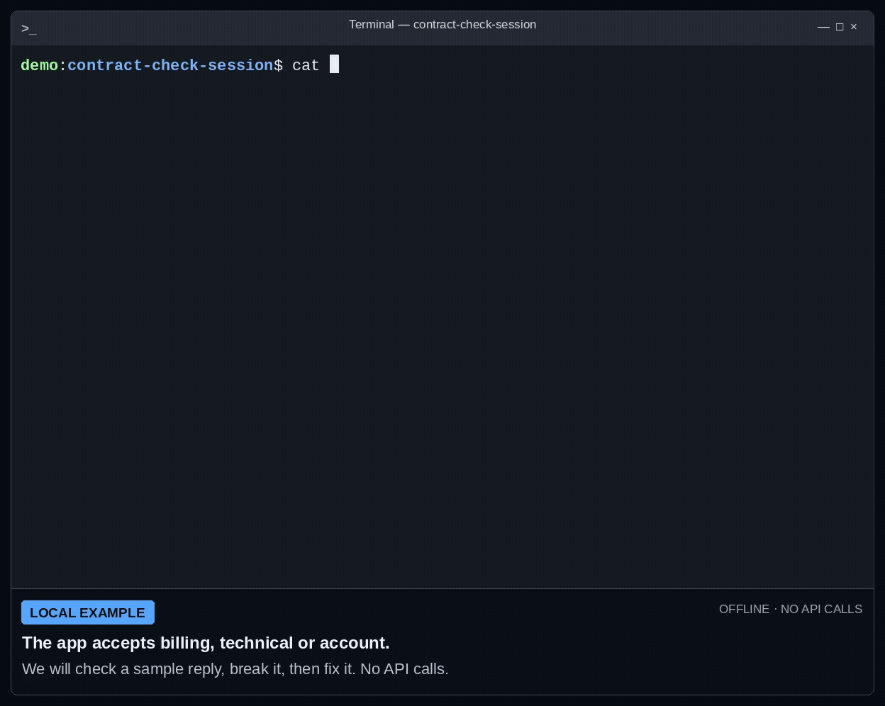
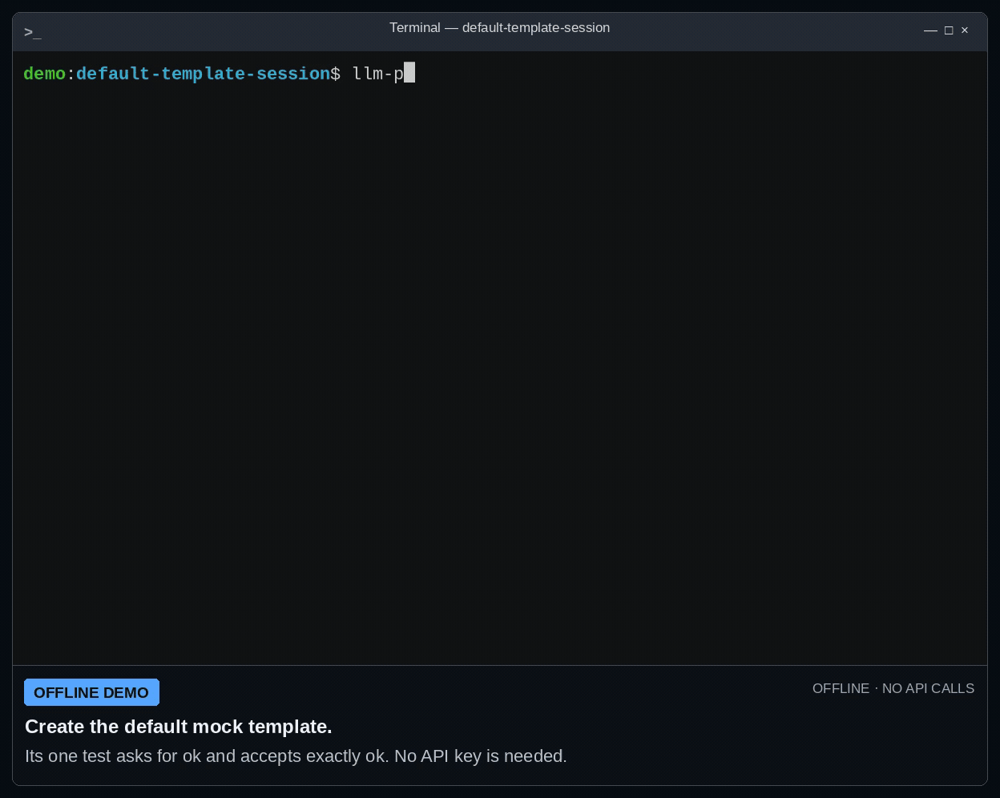
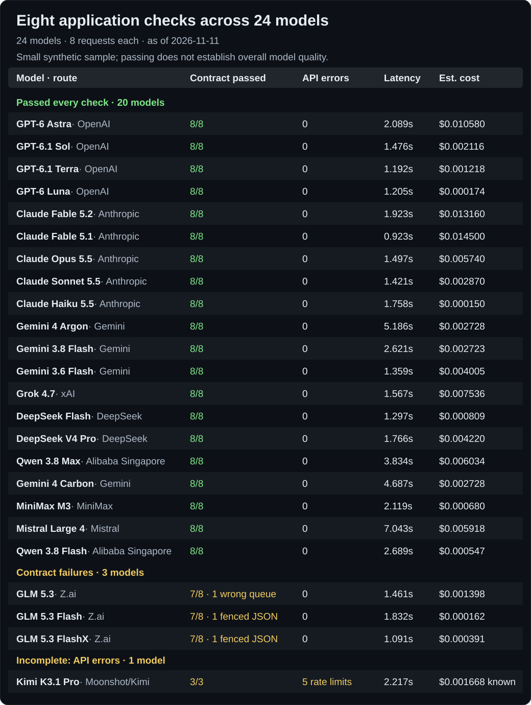

# LLM Preflight

<!-- mcp-name: io.github.feronovak/llm-preflight -->

**Last reviewed:** 2026-11-11 · **As of:** v2.24.2

[](https://pypi.org/project/llm-preflight/)
[](https://github.com/feronovak/llm-preflight/actions/workflows/tests.yml)
[](https://github.com/feronovak/llm-preflight/blob/main/LICENSE)

**Check LLM responses against the output rules your application depends on—before changing a model, prompt, schema, or provider.**

Define the JSON shape, routing labels, or exact output your feature needs.
Check responses against those rules, preview provider requests and estimated
cost, and keep the decision, latency and cost as evidence for the change review.
It also tells you which literal model IDs in your code are retired or retiring
(Anthropic, OpenAI and selected Gemini models).

A passing run is evidence for your account, prompts and validators. It is not
production approval.

Built for engineers maintaining an LLM feature. Runs locally as a CLI, GitHub
Action, or MCP server. Python 3.10+; no third-party runtime dependencies.

[Try it](#try-it-in-60-seconds) · [Observed models](#observed-results-on-a-support-routing-contract) · [Use your own contract](#first-live-run) · [CI and agents](#cli-ci-and-mcp)

## Try it in 60 seconds

In a new directory, install the tool. No API key or provider request is needed:

```bash
python3 -m venv .venv
. .venv/bin/activate
python3 -m pip install llm-preflight
```

The activation command is for POSIX shells; PowerShell uses
`.\.venv\Scripts\Activate.ps1`.

Already have LLM code? `llm-preflight --audit-source .` reports literal model
IDs marked retired or retiring in the bundled snapshot. No config or key is
needed. Bundled rows go stale 30 days after review; reports show the date as
`snapshot.valid_until`.

### 1. Catch an invalid response

Save this as `routing.json`. The app accepts `billing`, `technical` or
`account`. The config has two response fixtures: `model-reply` must pass and
`negative-control` (`INVALID`) must fail:

```json
{
  "prompt": "I was charged twice. Reply with only the support queue label.",
  "models": [{"name": "local-mock", "provider": "mock", "model": "local", "response": "billing"}],
  "validation": {"allowed_values": ["billing", "technical", "account"]},
  "validation_fixtures": [
    {"name": "model-reply", "response": "billing", "expect": "pass"},
    {"name": "negative-control", "response": "INVALID", "expect": "fail"}
  ]
}
```

```bash
llm-preflight routing.json --contract-check --no-env-file
```

Both fixtures behave as expected and the command exits `0`. Now change the
`model-reply` response from `billing` to `sales` and run it again: the check
fails and exits `1`. Restore `billing` and it passes again. The 23-second
session below runs the same validator (`allowed_values` `billing`, `technical`,
`account`) and the same two fixtures through the same pass, fail, pass flow, with
its own prompt and file name:



*Real CLI output with synthetic response fixtures. This checks the validator;
it makes no provider requests and does not execute your application's parser.*
[Watch the MP4](https://github.com/feronovak/llm-preflight/blob/main/docs/images/contract-check-session.mp4).

`--contract-check` exits `0` when every fixture behaves as expected, `1` when
one does not, and `2` for an invalid config.

### 2. Now a mock benchmark run

The mock benchmark has a different config and a different decision:

The config file is named `benchmark.json` because it also drives benchmark runs;
the same file holds a contract's validators and fixtures.

```bash
llm-preflight init
llm-preflight benchmark.json --no-save --no-env-file
```

`init` refuses to overwrite an existing config. Look for `local-mock` with
`PASS` in the quality gate: the mock replied `ok` and passed the exact-output
test. The overall decision is `inconclusive` (exit `3`) because a local mock
provides no live-provider evidence. The demo worked; it cannot approve a model.
`--no-save` skips JSON/Markdown result artifacts; `--no-env-file` skips credential files.

### Watch the interactive default template (30 seconds)

Select the mock and default `Reply with ok` test, review the plan, and confirm
the local run. The session also reads the same decision through CLI JSON:



*Local test: passed. Live provider: not tested. No API keys or provider calls.*
[Watch the MP4](https://github.com/feronovak/llm-preflight/blob/main/docs/images/default-template-evidence-session.mp4)
or start with the [text walkthrough](https://github.com/feronovak/llm-preflight/blob/main/docs/getting-started/safe-demo.md)
and [interactive CLI JSON example](https://github.com/feronovak/llm-preflight/blob/main/docs/guides/interactive-runs.md#default-template-walkthrough).

### Read the decision

For benchmark runs, read the decision before acting:

- **`pass`, exit `0`:** the configured checks passed with the required evidence.
- **`fail`, exit `1`:** a configured check failed; inspect the cause.
- **`inconclusive`, exit `3`:** evidence is insufficient; read the blocking warnings.

## New

Claude Fable 5.2 and four more models in the comparison guide. Everything else
is on the [releases page](https://github.com/feronovak/llm-preflight/releases).

## Observed results on a support-routing contract

We ran a selection of **20 native model routes** through eight synthetic
support-routing and strict JSON cases each. **152 of 160 checks passed**: three
outputs failed their contract and five Kimi calls returned HTTP 429. **16
models passed all eight checks.** These are observations for this workload as
of 2026-11-11, not a ranking of general intelligence or production approval.

[](https://github.com/feronovak/llm-preflight/blob/main/docs/guides/observed-model-comparison.md)

Each request used a 1,024-token output allowance and one attempt, with no
retries. The known token-cost subtotal is **$0.08218127**; the total is unknown
because the five error responses supplied no usage. The
[comparison guide](https://github.com/feronovak/llm-preflight/blob/main/docs/guides/observed-model-comparison.md)
has every row, the method and the failure analysis.

Your model is not here? Check it against your own contract:
[use the result in your own project](https://github.com/feronovak/llm-preflight/blob/main/docs/guides/observed-model-comparison.md#use-the-result-in-your-own-project)
or start with the [first live run](#first-live-run).

## First live run

Start with one rule your application already enforces. The
[project integration guide](https://github.com/feronovak/llm-preflight/blob/main/docs/getting-started/project-integration.md)
provides a complete routing contract with accepted/rejected fixtures and a
no-spend pull-request check. Match your deployed prompt and response parser;
local fixture checks do not execute application code automatically.

To try a minimal provider starter instead:

```bash
llm-preflight init live.json --template provider \
  --provider openai --model gpt-6.1-sol --api-key-env OPENAI_API_KEY
```

The starter asks for exactly `ok`. Add this top-level field to `live.json`,
keeping its existing fields, to check the validator locally:

```json
{
  "validation_fixtures": [
    {"name": "accepted-label", "response": "ok", "expect": "pass"},
    {"name": "rejected-label", "response": "not ok", "expect": "fail"}
  ]
}
```

Set `OPENAI_API_KEY` in your shell or in an uncommitted `.env.production`
beside `live.json`. The config stores the variable name, never the key.
Preview the check without making a generation request:

```bash
llm-preflight live.json --contract-check
llm-preflight live.json --doctor
llm-preflight live.json --pricing-check
llm-preflight live.json --dry-run
```

The starter has a three-request limit and a $0.05 estimated-cost cap. Resolve
warnings and review the route, retry-expanded request bound, pricing and
retention settings. The starter saves failed responses by default; review
artifacts before sharing them.

**Paid request:** only after reviewing and authorizing that plan, run:

```bash
llm-preflight live.json
```

A direct CLI run has no separate approval prompt. Results are saved as JSON
and Markdown under `results/` unless you use `--no-save`. The CLI reads the
config-adjacent `.env.production` without replacing existing shell values;
choose another file with `--env-file PATH` or skip it with `--no-env-file`.

### Render a review report

A review artifact retains the decision, contract validity, latency, usage,
estimated cost and blocking warnings. Render saved schema-version-1 JSON as
a standalone report without another provider request. Substitute the saved
JSON path printed by your run for `results/run.json`:

```bash
llm-preflight report results/run.json --output report.html
```

The renderer omits prompts, responses, local paths and identifying run metadata.
For reproducible examples, run these from a **source checkout**:

```bash
python3 -m llm_preflight report examples/reports/schema-baseline.json --format markdown
python3 -m llm_preflight report examples/reports/schema-break.json --format markdown
```

The first synthetic result passes; the second reports `contract_failure`, 67%
contract validity and one contract-only failure. The
[report gallery](https://github.com/feronovak/llm-preflight/tree/main/examples/reports)
also demonstrates a gate blocked with `no_record` (exit `1`). These fixtures
make no provider calls and cannot supply attested CI evidence.

## Choose your path

- **Set up a real project.** Adapt one application rule with the
  [project integration guide](https://github.com/feronovak/llm-preflight/blob/main/docs/getting-started/project-integration.md).
- **Validate a change.** Compare approved and candidate configurations with the
  [model-change guide](https://github.com/feronovak/llm-preflight/blob/main/docs/guides/model-change.md).
- **Automate an established contract.** Use
  [CI and JSON output](https://github.com/feronovak/llm-preflight/blob/main/docs/automation/ci.md)
  or the [GitHub Action](https://github.com/feronovak/llm-preflight/blob/main/docs/automation/github-action.md).
- **Configure a coding agent.** Start with
  `llm-preflight-mcp --workspace "$PWD"` in a trusted repository and follow
  [MCP for coding agents](#mcp-for-coding-agents) and the
  [MCP server guide](https://github.com/feronovak/llm-preflight/blob/main/docs/automation/mcp.md).
- **Run everyday jobs.** Audit model IDs with `llm-preflight --audit-source .`
  ([model retirements](https://github.com/feronovak/llm-preflight/blob/main/docs/guides/retirements.md)),
  replace a retired model, inspect pricing, review Git changes, discover a
  candidate with the
  [model catalog guide](https://github.com/feronovak/llm-preflight/blob/main/docs/guides/model-catalog.md),
  and change a model safely:
  [common jobs](https://github.com/feronovak/llm-preflight/blob/main/docs/guides/model-change.md#common-jobs)
  and [change a model safely](https://github.com/feronovak/llm-preflight/blob/main/docs/guides/model-change.md#change-a-model-safely).

## CLI, CI, and MCP

Works as a CLI, GitHub Action, and local MCP server. The
[Action](https://github.com/feronovak/llm-preflight/blob/main/docs/automation/github-action.md)
defaults to no generation requests. Rules for coding agents are in
[MCP for coding agents](#mcp-for-coding-agents).

**No preflight, no merge.** With a required check configured, the offline gate
requires a fresh passing CI record matching the current contract, routes,
prompts and run selection. Protect the producer and gate workflows; signed
records also need `gh attestation verify` before the gate. Follow
[proof of preflight](https://github.com/feronovak/llm-preflight/blob/main/docs/guides/proof-of-preflight.md)
to configure it. A local fixture pass or installed package does not enforce a
merge policy. It doesn't certify production behaviour. It proves the check was done.

### MCP for coding agents

Install the package (`python3 -m pip install llm-preflight`), then configure the
stdio command `llm-preflight-mcp` in your MCP client. If you installed into a
virtual environment, set `command` to the absolute path of that environment's
`llm-preflight-mcp`, or install it with a pipx-style tool so it is on `PATH`.

```json
{
  "mcpServers": {
    "llm-preflight": {
      "command": "llm-preflight-mcp",
      "args": ["--workspace", "/absolute/path/to/repository"]
    }
  }
}
```

The server has eight tools:

| Tool | What it does | Can spend money |
|---|---|---|
| `audit_source` | Find literal model IDs in workspace files and report retirement and pricing verdicts | no |
| `validate_config` | Validate a benchmark config locally | no |
| `dry_run_plan` | Return a redacted run and cost plan | no |
| `run_preflight` | Run a preflight; a live run needs `confirm_paid_run` | **yes** |
| `diff_baseline` | Compare two saved result files | no |
| `verify` | Report a proof-of-preflight record's integrity and freshness | no |
| `gate` | Decide offline whether a fresh passing CI record covers the contract | no |
| `migrate_plan` | Report the provider-named replacement for each retired model | no |

For an existing contract, begin with `validate_config` and `dry_run_plan`.

**Agent rules**

- **Paid runs need a person.** A live `run_preflight` requires explicit
  confirmation, and `confirm_paid_run` is not proof that a person authorized
  spending: keep the client's tool approval enabled. Never infer permission for
  paid work from a gate result.
- **Read the structured decision** (`pass`, `fail`, `inconclusive`) and its
  blocking warnings, and report missing evidence. Do not summarize it away.
- **Never weaken a validator** to get a pass.

The CLI gives the same decision as JSON with `--json`, for example
`llm-preflight benchmark.json --json --no-save`. Exit codes: `0` pass, `1` fail
or blocked, `2` invalid input or setup failure, `3` inconclusive. The
`agent-smoke` suite with `--smoke` makes six requests per model before
configured retries. See the
[MCP guide](https://github.com/feronovak/llm-preflight/blob/main/docs/automation/mcp.md)
for request/result examples and workspace boundaries, and the
[coding-agent workflow](https://github.com/feronovak/llm-preflight/blob/main/docs/automation/coding-agents.md)
for CLI commands.

## Safety boundary

Results apply to the configured account, route, prompts and validators at one
time. Model responses remain stochastic. Deterministic validation checks the
rules you declare; it does not establish semantic accuracy or production safety.
Preview limits before live requests and keep paid-run authority with the person
responsible for the integration.

## How it compares

Use this project for a bounded contract check and reviewable evidence before
an integration change. Keep the tools you already have; this adds what they
usually do not:

| You already have | It is good for | LLM Preflight adds |
|---|---|---|
| A pytest assertion on a model reply | Unit-level checks in your test suite | A merge gate tied to a fresh CI record of the contract check |
| An evaluation framework | Semantic scoring and statistical comparisons | Spend-capped dry runs that preview the provider request and estimated cost before any live call |
| An observability tool | Production tracing and incident investigation | Retirement and pricing snapshots for the model IDs you use, checked locally |

See [when to use it](https://github.com/feronovak/llm-preflight/blob/main/docs/product/when-to-use.md).

## Help, documentation, and contributing

[Ask for setup help or a contract example](https://github.com/feronovak/llm-preflight/issues/new?template=setup-help.yml).
Include the version, intended check and redacted output. Never share keys,
private prompts or provider responses. Use the
[security policy](https://github.com/feronovak/llm-preflight/blob/main/SECURITY.md)
for vulnerabilities.

The [documentation homepage](https://github.com/feronovak/llm-preflight/blob/main/docs/index.md)
routes by task. Consult [CLI reference](https://github.com/feronovak/llm-preflight/blob/main/docs/reference/cli.md),
[configuration](https://github.com/feronovak/llm-preflight/blob/main/docs/reference/configuration.md)
and [result JSON](https://github.com/feronovak/llm-preflight/blob/main/docs/reference/results.md)
for exact behavior. Native routes and dated pricing coverage are listed in
[current snapshots](https://github.com/feronovak/llm-preflight/blob/main/docs/guides/current-snapshots.md).
The [AI implementation testing guide](https://github.com/feronovak/llm-preflight/blob/main/docs/automation/agent-validation.md)
explains the intended workflow and scope.

Release notes for every version are in the [changelog](https://github.com/feronovak/llm-preflight/blob/main/CHANGELOG.md).

See [Contributing](https://github.com/feronovak/llm-preflight/blob/main/CONTRIBUTING.md)
for development and documentation standards. Released under the
[MIT License](https://github.com/feronovak/llm-preflight/blob/main/LICENSE).
