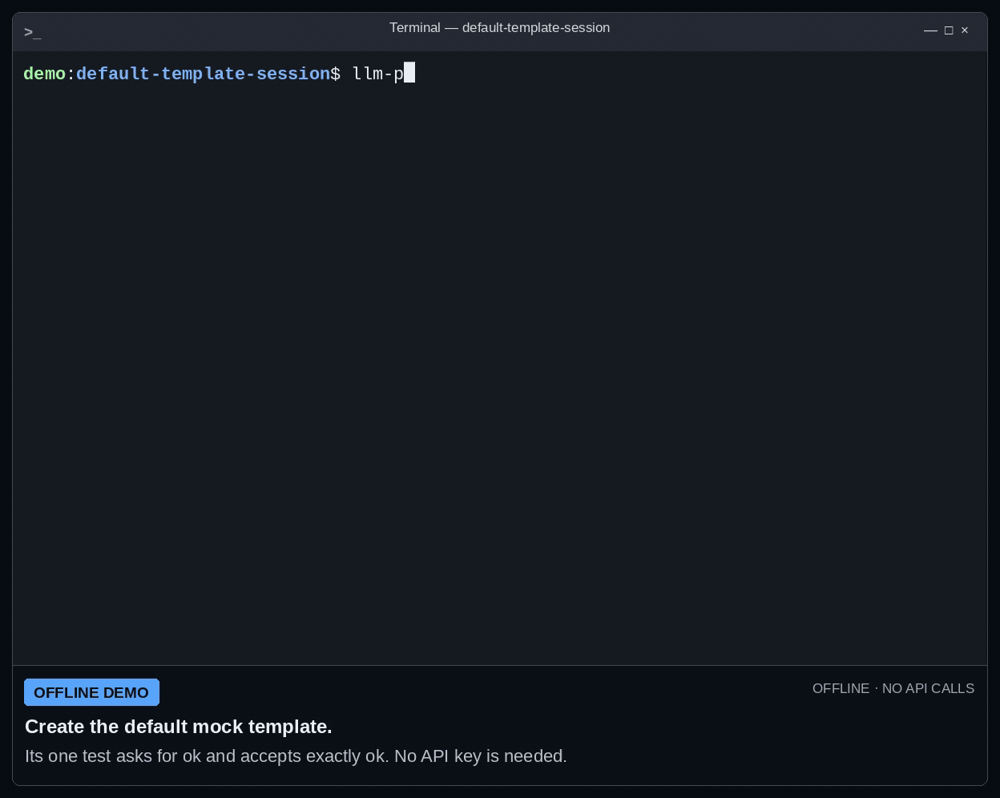

# Interactive benchmark mode

**Last reviewed:** 2026-10-19 · **As of:** v2.22.1

Interactive mode helps you choose models and workload from an existing project
configuration, review local evidence, and decide what to do next. Version
2.21.0 adds the guided review and action menu below.

```bash
llm-preflight benchmark.json --interactive
```

For a no-spend walkthrough using synthetic routing fixtures:

```bash
llm-preflight examples/interactive-contract.json --interactive --dry-run --no-env-file
```

Enter `all`, press Enter for the config prompt, accept one repetition, and
choose `4` for never. `--dry-run` then prints the plan without asking for a run
or retry-risk acceptance. The local fixtures prove only that the declared
validator accepts and rejects those examples. They do not execute your
application's parser or prove that a model meets the contract.

## Default template walkthrough

Start in a new directory with the installed CLI:

```bash
llm-preflight init
llm-preflight benchmark.json --interactive --no-save --no-env-file
```

The default template uses a local mock and one configured test: `Reply with
ok.`, validated as exactly `ok`. Follow these choices:

| Prompt | Input | What it selects |
|---|---|---|
| Models | `all` | The template's one local mock |
| Tests | Enter | The template's configured prompt |
| Repetitions | Enter | One repetition |
| Stop mode | `4` | Never stop early |
| Next action | `r` | Review a local mock run |
| Run local mock benchmark? | `y` | Start that local run |

Enter at the test menu selects the configured prompt; `all` selects the
built-in functional test pack. The recording uses the default configured test.
The plan shows one nominal request and up to two attempts, both local mock
work. No API key, env file, or provider call is used. No result files are
saved by these flags.



[MP4 version](../images/default-template-session.mp4).
The 29-second recording is a continuous shell session with full native menus
and output. Explanatory captions sit below the terminal. Its last commands
save CLI JSON to `result.json` and inspect the decision fields. Mock timing and token
figures are simulated. `API OK / TEST OK` means the mock's response met the
configured rule; the overall decision stays **inconclusive** (exit `3`)
because a mock supplies no live-provider evidence.

## CLI JSON communication

Automation can use the same template without menus. After `init`, send these
two CLI requests; the first returns exit `0`, the local run returns exit `3`:

```bash
llm-preflight benchmark.json --dry-run --json --no-env-file
llm-preflight benchmark.json --json --no-save --no-env-file
```

The first response includes this plan excerpt:

```json
{
  "tests": ["config prompt"],
  "requests": 1,
  "possible_requests": 2
}
```

The second response includes this decision excerpt:

```json
{
  "decision": {
    "state": "inconclusive",
    "reason_code": "degraded_evidence",
    "blocking_warnings": [
      "Mock-only runs do not provide live-provider evidence."
    ]
  }
}
```

Both commands return larger JSON objects; these are selected fields, not
complete messages. Consume the JSON decision and process exit code together.
Handle the expected exit `3` explicitly in automation; a successful mock test
is not approval of a provider or a merge. Use the [MCP guide](../automation/mcp.md)
when an agent needs structured tool requests instead of CLI commands.

## Select and review

1. Models: choose numbers, `all`, a provider such as `openai`, or a family such
   as `openrouter/qwen`. `provider/model-id` selects the exact model when it
   exists. `search TEXT` filters the displayed list; numbers always refer to
   the original list. Enter selects all on the first visit and keeps your
   selection when revisiting it. The screen reports the selected count.
2. Tests: choose numbers, names, `agent-smoke`, or `all` (functional tests,
   excluding load). Enter uses the config's top-level prompt and removes saved
   `profiles`. With only named custom prompts, select their names. On a repeat
   visit, `keep` reuses the previous test selection. Built-in tests are an
   explicit choice; use your project's contract to check its consumer behavior.
3. Repetitions: choose a positive integer. Enter accepts the displayed default;
   revisiting this stage keeps your previous value as the default.
4. Stop mode: choose API error, failed test, either, or `never`. Never removes
   a saved stop rule. Enter accepts the displayed default. A stray `y` here
   cannot authorize execution.

Use `back` to revisit the previous selection and `q` to cancel at any prompt.
Invalid selections explain the problem and let you try again. Ctrl-C or EOF
ends with exit 130 and keeps exports you already saved. Plain output has no
screen-clearing sequences when redirected; with `--json`, prompts, menus and
progress go to stderr and stdout contains the final JSON document.

The preview uses the shared CLI/MCP dry-run plan: effective models/tests,
nominal and retry-expanded request bounds, available or unavailable estimated
cost, pricing freshness, retirement evidence, smoke eligibility, retention and
per-test breakdown. A retirement `fail` or `inconclusive` is planning evidence;
`--ci` applies the existing retirement exit rules. Estimates are not invoices.
Read eligibility and retirement next steps before deciding to run.

Declared contract fixtures run locally before execution confirmation. Failed
fixtures block the run action; preview, export and editing remain available.
Missing fixtures are shown as unproven consumer correctness. Correct the
contract rather than weaken a validator to make the run pass.

## Choose the next action

- `p` or Enter: print the selected plan and finish without generation.
- `s`: save the selected config at an explicit path, then return to this menu.
- `x`: export the shared plan JSON at an explicit path, then return to this menu.
- `e` or `back`: edit choices. Valid choices remain available for reuse.
- `r`: review execution. Mock-only configurations ask to run a **local mock**;
  a configuration containing a provider model asks to run a **paid benchmark**.
  Both require a separate `y`. Every other confirmation answer cancels.
- `q`: cancel without starting a benchmark.

Retry-expanded work still obeys budget checks. If only `max_requests` is
exceeded, execution requires the exact `ACCEPT N` retry-risk consent; Enter
cancels. Cost limits and strict pricing are not bypassed. Preview/export do not
ask for this consent or change the saved limits. Mixed mock/provider selections
use the paid confirmation.

For configured models, preview, cancellation and mock-only execution do not
read environment files. Provider discovery can need credentials and make
metadata requests before selection. Use `--no-env-file` to disable all env-file
loading; it does not disable discovery. No generation occurs before the paid
confirmation.

## Save and reuse a selection

Exports never overwrite existing files, including symbolic links. The selected
config removes runtime fields and redacts inline credentials and headers while
preserving API-key environment-variable names and the `env_file` reference.
Schema property names and validation rules are preserved, including fields
named `password` or `_private`. If redaction would change a validator or
fixture value, saving is refused; use synthetic fixtures and non-secret
validator values first. Save it beside the original config so relative
env/image references keep their meaning. A plan can be exported elsewhere. Enter at an export-path prompt
returns to the menu.

After saving a config, the screen prints a quoted command such as:

```bash
llm-preflight 'selected config.json' --dry-run --no-env-file
```

That command previews the same selected workload without a menu. Redacted
inline credentials/headers must be restored through your reviewed configuration
and environment-variable references before executing it. Saved configs still
contain your prompts and synthetic response fixtures; inspect them before sharing.
A plan is evidence, not an executable configuration or authorization.

## Read the result

To exercise the local mock, run the walkthrough without `--dry-run`, select
`r`, then confirm `y`:

```bash
llm-preflight examples/interactive-contract.json --interactive --no-env-file
```

The decision stays **inconclusive** (exit 3): mock responses do not establish
provider compatibility, latency or spend. The final result states the decision
and reason. A saved run prints its JSON, Markdown report and decision-summary
paths, plus a command to render offline HTML. `--no-save` omits those paths.

For scripted planning, use `--dry-run --json`; for scripted execution, run the
reviewed config with the existing CLI budget and exit semantics. Passing
results are scoped evidence and require a separate owner production decision.

## Earlier recorded comparison

The capture below predates the 2.21.0 action menu; it records the earlier
selection/confirmation flow and is not evidence for this UI refresh.


This capture is a real paid run: two flagship models compared on two custom
chat prompts, selected interactively. The plan screen shows the request and
cost ceiling before confirmation, every request line reports its own cost,
and the whole run cost $0.005404. The config is
[examples/flagship-comparison.json](../../examples/flagship-comparison.json).
The current example also includes GPT-6.1 Sol, GLM-5.3 and reviewed bundled pricing;
that model was not part of the original capture. Swap in your own model IDs
and prompts for a current run.

## Catalogue and approval

`catalog probe` has its own selector and consent prompt. It sends one minimal
compatibility request for a text candidate, without retaining response text,
when the catalogue labels it **Needs one probe**. It is separate from this
benchmark menu.

```bash
llm-preflight catalog probe benchmarks/watch.json
llm-preflight benchmarks/candidates.json --interactive --approve-to benchmarks/approved.json
```

After a saved, passing provider run, `--approve-to` offers eligible models for
explicit approval; mock or inconclusive results cannot promote a model.
Interactive mode cannot be combined with `--catalog`, `--tests`, `--profiles`,
`--prompt`, or `--migration-check`. See the [CLI reference](../reference/cli.md)
and [Model catalogue](model-catalog.md) for the full workflows.
